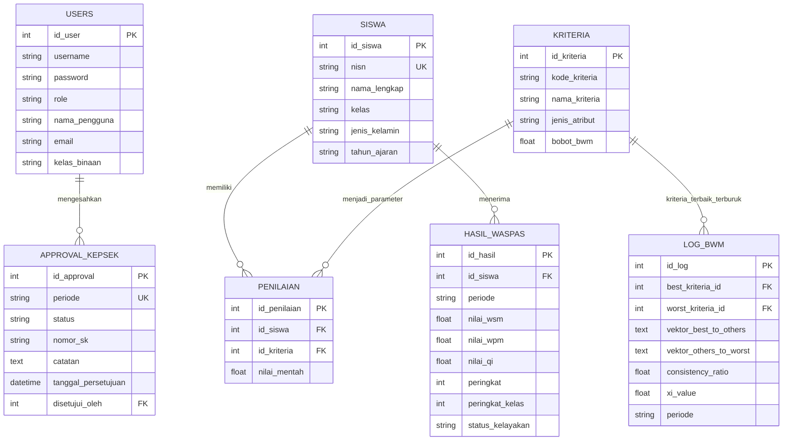
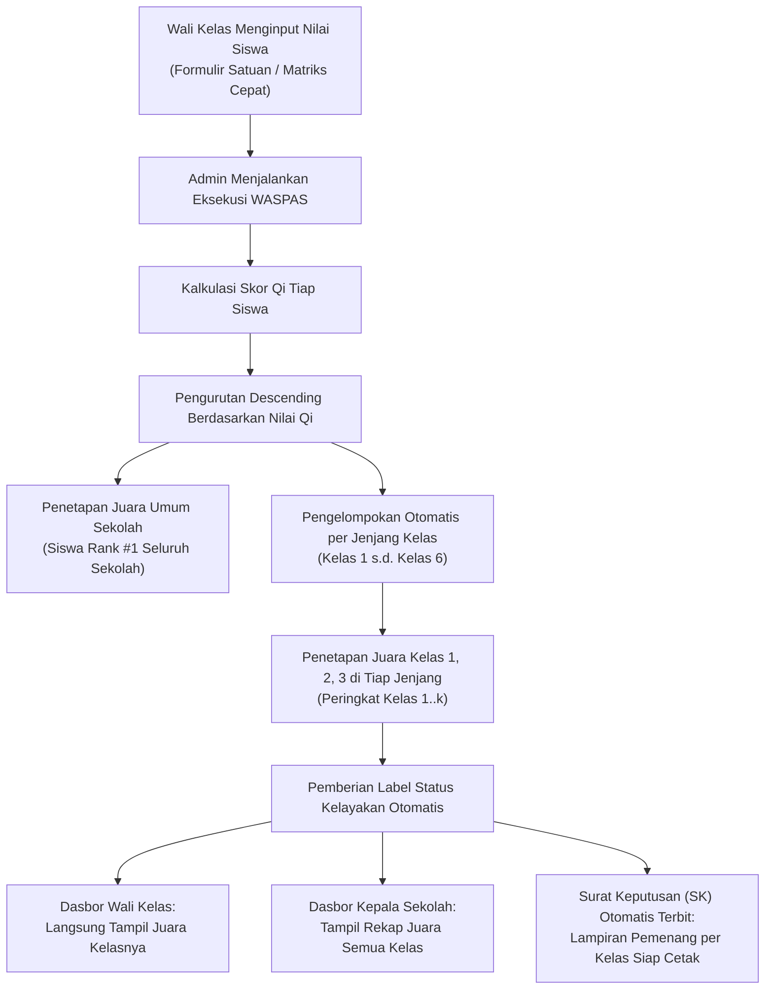
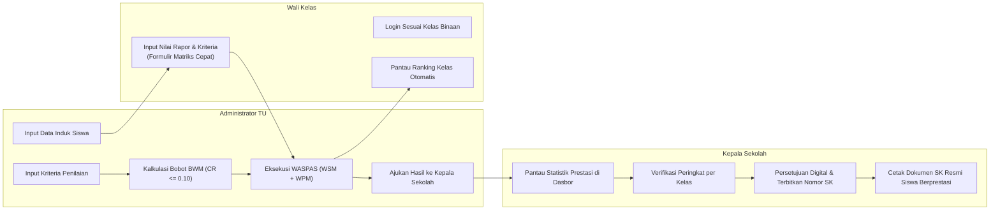

# BLUEPRINT PENGEMBANGAN SISTEM
# SINTESA SDN PLAKPAK 1

**Sistem Informasi Penilaian Siswa Berprestasi Menggunakan Metode BWM dan WASPAS Berbasis Web**  
*Studi Kasus: SD Negeri Plakpak 1, Kecamatan Pegantenan, Kabupaten Pamekasan, Jawa Timur*

---

## DAFTAR ISI
1. [BAB I: Pendahuluan & Gambaran Umum Sistem](#bab-i-pendahuluan--gambaran-umum-sistem)
2. [BAB II: Arsitektur Perangkat Lunak & Spesifikasi Teknologi](#bab-ii-arsitektur-perangkat-lunak--spesifikasi-teknologi)
3. [BAB III: Struktur Basis Data & Entitas Relasi (ERD)](#bab-iii-struktur-basis-data--entitas-relasi-erd)
4. [BAB IV: Formulasi Matematis & Algoritma Keputusan (BWM - WASPAS)](#bab-iv-formulasi-matematis--algoritma-keputusan-bwm---waspas)
5. [BAB V: Mekanisme Pemeringkatan Otomatis per Kelas & per Tahun Ajaran](#bab-v-mekanisme-pemeringkatan-otomatis-per-kelas--per-tahun-ajaran)
6. [BAB VI: Matriks Hak Akses Pengguna & Rincian Fitur Aplikasi](#bab-vi-matriks-hak-akses-pengguna--rincian-fitur-aplikasi)
7. [BAB VII: Diagram Alur Kerja Sistem (Flowchart)](#bab-vii-diagram-alur-kerja-sistem-flowchart)
8. [BAB VIII: Struktur Direktori Proyek & Implementasi Kode](#bab-viii-struktur-direktori-proyek--implementasi-kode)
9. [BAB IX: Standar Pengujian & Panduan Operasional](#bab-ix-standar-pengujian--panduan-operasional)

---

## BAB I: Pendahuluan & Gambaran Umum Sistem

### 1.1 Latar Belakang
Di lingkungan institusi pendidikan dasar, khususnya di **SD Negeri Plakpak 1 Pegantenan**, proses pemilihan siswa berprestasi pada setiap akhir tahun ajaran merupakan agenda rutin yang sangat krusial. Penilaian ini tidak hanya menjadi wujud apresiasi bagi peserta didik, namun juga menjadi dasar penunjukan duta sekolah dalam kompetisi sains, seni, maupun olimpiade tingkat gugus, kecamatan, dan kabupaten.

Permasalahan yang dihadapi saat ini meliputi:
1. **Rekapitulasi Manual yang Melelahkan**: Guru wali kelas harus menghitung rata-rata rapor, absensi, catatan kedisiplinan, dan kegiatan ekstrakurikuler secara terpisah menggunakan kalkulator atau spreadsheet lepas.
2. **Subjektivitas Bobot Penilaian**: Penentuan mana kriteria yang lebih penting (apakah nilai rapor atau kedisiplinan) kerap diperdebatkan tanpa tolak ukur matematis yang terukur dan teruji konsistensinya.
3. **Kebutuhan Juara di Setiap Tingkat Kelas**: Sekolah dasar memerlukan penetapan pemenang berjenjang: **Juara 1, 2, dan 3 di setiap tingkatan kelas (Kelas 1 s.d. Kelas 6)** pada setiap tahun ajaran, di samping penetapan **Juara Umum Tingkat Sekolah**. Rekapitulasi manual antar-jenjang sering menimbulkan kekeliruan urutan dan memakan waktu berhari-hari.

### 1.2 Solusi Sistem (SINTESA SDN PLAKPAK 1)
Aplikasi **SINTESA SDN PLAKPAK 1** (*Sistem Informasi Penilaian Siswa Berprestasi*) dirancang khusus untuk memecahkan permasalahan di atas dengan mengintegrasikan:
- **Best-Worst Method (BWM)**: Menghitung pembobotan kriteria secara terstruktur melalui perbandingan kriteria terbaik (*Best*) dan kriteria terburuk (*Worst*), diselesaikan dengan optimasi *Linear Programming Simpleks Dua Tahap* yang menjamin konsistensi preferensi ($CR \le 0.10$).
- **Weighted Aggregated Sum Product Assessment (WASPAS)**: Menentukan perankingan multi-kriteria yang akurat melalui penggabungan *Weighted Sum Model (WSM)* dan *Weighted Product Model (WPM)* dengan parameter agregasi $\lambda$.
- **Otomasi Pemeringkatan per Jenjang Kelas & per Tahun Ajaran**: Begitu wali kelas menginput nilai mentah, sistem secara instan mengelompokkan dan menetapkan Juara 1, 2, 3 di masing-masing kelas serta Juara Umum Sekolah tanpa ada rekapitulasi manual lagi.
- **Penerbitan Surat Keputusan (SK) Resmi**: Kepala Sekolah dapat memverifikasi digital dan mencetak naskah SK penetapan siswa berprestasi lengkap dengan lampiran resmi siap tanda tangan.

### 1.3 Tujuan Sistem
1. Mengotomasi proses rekapitulasi penilaian prestasi siswa per kelas dan per tahun ajaran secara cepat, tepat, dan transparan.
2. Menghilangkan subjektivitas penentuan bobot parameter penilaian melalui metode BWM yang teruji konsistensinya.
3. Menghasilkan perankingan komprehensif menggunakan metode WASPAS yang dapat dipertanggungjawabkan secara ilmiah.
4. Memudahkan Kepala Sekolah dalam memantau statistik mutu siswa dan mengesahkan SK penetapan secara digital.

---

## BAB II: Arsitektur Perangkat Lunak & Spesifikasi Teknologi

### 2.1 Pola Arsitektur
Sistem dibangun mengadopsi pola arsitektur **Model-View-Controller (MVC)** yang diperkaya dengan **Service Layer Pattern**:
- **Controller Layer**: Bertugas menangani *HTTP request/response*, validasi masukan formulir, dan orkestrasi hak akses per peran.
- **Service Layer (`app/Services/`)**: Mengisolasi logika komputasi matematika murni (*BwmService* dan *WaspasService*) agar terpisah total dari antarmuka pengguna sehingga mudah diuji (*unit-tested*) dan dipelihara.
- **Model Layer (`app/Models/`)**: Merepresentasikan struktur entitas basis data dengan *Eloquent ORM*, relasi relasional, dan *type casting*.
- **View Layer (`resources/views/`)**: Antarmuka web interaktif berbasis *Blade Templating Engine*.

### 2.2 Spesifikasi Teknologi
| Komponen | Teknologi Terpilih | Versi / Keterangan |
| :--- | :--- | :--- |
| **Bahasa Pemrograman** | PHP | PHP 8.2+ (Typed Properties, Match Expression) |
| **Kerangka Kerja (Framework)** | Laravel | Laravel 12.x (Clean Structure, Eloquent ORM) |
| **Basis Data** | MySQL / SQLite | Didukung penuh via Laravel Migrations |
| **Antarmuka (Frontend)** | HTML5, CSS3, JavaScript | Desain responsif, clean institutional look |
| **Framework CSS** | Bootstrap | Bootstrap 5.3.3 via CDN |
| **Ikonografi** | Bootstrap Icons | v1.11.3 |
| **Tipografi** | Google Fonts | Plus Jakarta Sans & Times New Roman (untuk dokumen SK) |
| **Visualisasi Data** | Chart.js | v4.4.1 (Doughnut, Bar, & Radar Charts) |
| **Format Bahasa Antarmuka** | Bahasa Indonesia Baku | 100% terlokalisasi via `lang/id/` |

### 2.3 Standar Desain Visual
Antarmuka sistem menghindari kesan template AI / SaaS komersial generik (tanpa gradien neon atau *dark-mode purple/cyan*). Sistem mengadopsi identitas visual instansi pendidikan formal:
- **Warna Utama (Institutional Green)**: `#195e38` (Karakter resmi, teduh, mencerminkan Kementerian Pendidikan).
- **Warna Aksen Emas (Achievement Gold)**: `#b45309` / `#fef3c7` (Simbol prestasi dan keunggulan siswa).
- **Kanvas Netral**: `#f1f5f9` dengan kartu putih `#ffffff` dan garis tepi terstruktur `#cbd5e1`.

---

## BAB III: Struktur Basis Data & Entitas Relasi (ERD)

### 3.1 Diagram Relasi Entitas (ERD)



### 3.2 Rincian Kamus Data (Data Dictionary)

#### 1. Tabel `users`
Menyimpan akun pengguna untuk otentikasi multi-peran.
- `id_user` (INT, Primary Key, Auto Increment)
- `username` (VARCHAR 100, Unique)
- `password` (VARCHAR 255, Bcrypt Hashed)
- `role` (ENUM: `'admin'`, `'walikelas'`, `'kepsek'`)
- `nama_pengguna` (VARCHAR 150)
- `email` (VARCHAR 150, Nullable)
- `kelas_binaan` (VARCHAR 50, Nullable, misal: `'Kelas 4'`, `'Kelas 5'`, `'Kelas 6'`)
- `created_at`, `updated_at` (TIMESTAMP)

#### 2. Tabel `kriteria`
Parameter penilaian siswa beserta bobot hasil komputasi BWM.
- `id_kriteria` (INT, Primary Key, Auto Increment)
- `kode_kriteria` (VARCHAR 20, Unique, misal: `'C1'`, `'C2'`, `'C3'`, dst.)
- `nama_kriteria` (VARCHAR 150)
- `jenis_atribut` (ENUM: `'Benefit'`, `'Cost'`)
- `bobot_bwm` (DOUBLE 8,4, default 0.0)
- `created_at`, `updated_at` (TIMESTAMP)

#### 3. Tabel `siswa`
Data induk peserta didik sebagai alternatif penilaian.
- `id_siswa` (INT, Primary Key, Auto Increment)
- `nisn` (VARCHAR 20, Unique, 10 digit NISN resmi)
- `nama_lengkap` (VARCHAR 150)
- `kelas` (VARCHAR 50, misal: `'Kelas 1'`, `'Kelas 2'`, ..., `'Kelas 6'`)
- `jenis_kelamin` (ENUM: `'L'`, `'P'`)
- `tahun_ajaran` (VARCHAR 50, misal: `'2024/2025'`)
- `created_at`, `updated_at` (TIMESTAMP)

#### 4. Tabel `penilaian`
Data rekaman angka mentah yang dimasukkan wali kelas untuk tiap siswa dan kriteria.
- `id_penilaian` (INT, Primary Key, Auto Increment)
- `id_siswa` (INT, Foreign Key ke `siswa.id_siswa`, ON DELETE CASCADE)
- `id_kriteria` (INT, Foreign Key ke `kriteria.id_kriteria`, ON DELETE CASCADE)
- `nilai_mentah` (DOUBLE 8,2, skala 0–100 atau angka pelanggaran)
- `created_at`, `updated_at` (TIMESTAMP)

#### 5. Tabel `hasil_waspas`
Hasil akhir pemeringkatan yang terekam permanen untuk setiap periode akademik.
- `id_hasil` (INT, Primary Key, Auto Increment)
- `id_siswa` (INT, Foreign Key ke `siswa.id_siswa`, ON DELETE CASCADE)
- `periode` (VARCHAR 50)
- `nilai_wsm` (DOUBLE 10,6, skor penjumlahan terbobot)
- `nilai_wpm` (DOUBLE 10,6, skor perkalian terbobot)
- `nilai_qi` (DOUBLE 10,6, skor agregasi akhir WASPAS)
- `peringkat` (INT, ranking umum tingkat sekolah)
- `peringkat_kelas` (INT, ranking siswa di jenjang kelasnya sendiri)
- `status_kelayakan` (VARCHAR 100, label kelayakan prestasi)
- `created_at`, `updated_at` (TIMESTAMP)

#### 6. Tabel `log_bwm`
Jejak audit matematis penentuan bobot kriteria.
- `id_log` (INT, Primary Key, Auto Increment)
- `best_kriteria_id` (INT, Foreign Key ke `kriteria.id_kriteria`)
- `worst_kriteria_id` (INT, Foreign Key ke `kriteria.id_kriteria`)
- `vektor_best_to_others` (TEXT, format JSON)
- `vektor_others_to_worst` (TEXT, format JSON)
- `consistency_ratio` (DOUBLE 8,4, nilai CR)
- `xi_value` (DOUBLE 8,4, nilai optimal $\xi^*$)
- `periode` (VARCHAR 50)
- `created_at`, `updated_at` (TIMESTAMP)

#### 7. Tabel `approval_kepsek`
Rekam jejak persetujuan digital dan Surat Keputusan (SK) resmi oleh Kepala Sekolah.
- `id_approval` (INT, Primary Key, Auto Increment)
- `periode` (VARCHAR 50, Unique)
- `status` (ENUM: `'menunggu'`, `'disetujui'`, `'ditolak'`)
- `nomor_sk` (VARCHAR 100, Nullable, misal: `'421.2/084/SDN.PLK.1/2025'`)
- `catatan` (TEXT, Nullable)
- `tanggal_persetujuan` (DATETIME, Nullable)
- `disetujui_oleh` (INT, Foreign Key ke `users.id_user`, Nullable)
- `created_at`, `updated_at` (TIMESTAMP)

---

## BAB IV: Formulasi Matematis & Algoritma Keputusan (BWM - WASPAS)

### 4.1 Metode Best-Worst Method (BWM)
BWM (Rezaei, 2015) digunakan untuk menentukan bobot prioritas kriteria penilaian secara konsisten dan terhindar dari redundansi matriks perbandingan penuh (*full pairwise matrix*).

#### Langkah-langkah Matematis:
1. **Identifikasi Himpunan Kriteria**:  
   Ditetapkan himpunan kriteria keputusan $C = \{c_1, c_2, \dots, c_n\}$. Pada studi kasus SDN Plakpak 1:
   - $C_1$: Nilai Rata-rata Rapor (Benefit)
   - $C_2$: Kehadiran / Presensi (Benefit)
   - $C_3$: Sikap dan Karakter (Benefit)
   - $C_4$: Prestasi & Ekstrakurikuler (Benefit)
   - $C_5$: Pelanggaran / Kedisiplinan (Cost)

2. **Penentuan Kriteria Terbaik & Terburuk**:  
   Pengambil keputusan menetapkan kriteria paling berpengaruh/terbaik ($C_B$) dan paling kurang berpengaruh/terburuk ($C_W$).

3. **Pembentukan Vektor Best-to-Others ($A_B$)**:  
   Menentukan derajat preferensi kriteria terbaik $C_B$ terhadap kriteria lainnya $C_j$ menggunakan skala 1 sampai 9:
   $$A_B = (a_{B1}, a_{B2}, \dots, a_{Bn})$$
   dengan $a_{BB} = 1$.

4. **Pembentukan Vektor Others-to-Worst ($A_W$)**:  
   Menentukan preferensi seluruh kriteria $C_j$ terhadap kriteria terburuk $C_W$:
   $$A_W = (a_{1W}, a_{2W}, \dots, a_{nW})^T$$
   dengan $a_{WW} = 1$.

5. **Model Optimasi Linear Programming (Two-Phase Simplex Solver)**:  
   Untuk menentukan vektor bobot optimal $W^* = (w_1^*, w_2^*, \dots, w_n^*)$, sistem menyelesaikan formulasi linear tereduksi:
   $$\min \xi^L$$
   dengan kendala (*constraints*):
   $$\begin{aligned}
   |w_B - a_{Bj}w_j| &\le \xi^L, \quad \forall j \\
   |w_j - a_{jW}w_W| &\le \xi^L, \quad \forall j \\
   \sum_{j=1}^n w_j &= 1 \\
   w_j &\ge 0, \quad \forall j
   \end{aligned}$$

6. **Pengujian Rasio Konsistensi (Consistency Ratio / CR)**:  
   Dihitung nilai CR berdasarkan nilai optimal $\xi^*$ dan Indeks Konsistensi ($CI$) tabel Rezaei:
   $$CR = \frac{\xi^*}{CI}$$
   - Jika $CR \le 0.10$: Preferensi dinilai **sangat konsisten** dan bobot valid digunakan ke seluruh sistem.
   - Jika $CR > 0.10$: Sistem memberikan peringatan visual untuk mengevaluasi skala linguistik perbandingan.

---

### 4.2 Metode WASPAS (Weighted Aggregated Sum Product Assessment)
WASPAS (Zavadskas et al., 2012) menggabungkan model aditif (*Weighted Sum Model*) dan multiplikatif (*Weighted Product Model*) guna menghasilkan peringkat alternatif yang sangat stabil dan presisi.

#### Langkah-langkah Matematis:
1. **Pembentukan Matriks Keputusan ($X$)**:  
   Terdapat $m$ siswa dan $n$ kriteria:
   $$X = \begin{bmatrix}
   x_{11} & x_{12} & \dots & x_{1n} \\
   x_{21} & x_{22} & \dots & x_{2n} \\
   \vdots & \vdots & \ddots & \vdots \\
   x_{m1} & x_{m2} & \dots & x_{mn}
   \end{bmatrix}$$

2. **Normalisasi Matriks Keputusan ($R$)**:  
   - Untuk kriteria **Benefit** (semakin tinggi semakin baik):
     $$r_{ij} = \frac{x_{ij}}{\max_i x_{ij}}$$
   - Untuk kriteria **Cost** (semakin rendah semakin baik):
     $$r_{ij} = \frac{\min_i x_{ij}}{x_{ij}}$$

3. **Perhitungan Nilai WSM ($Q_i^{(1)}$)**:  
   $$Q_i^{(1)} = \sum_{j=1}^n r_{ij} \cdot w_j$$

4. **Perhitungan Nilai WPM ($Q_i^{(2)}$)**:  
   $$Q_i^{(2)} = \prod_{j=1}^n \left(r_{ij}\right)^{w_j}$$

5. **Perhitungan Skor Agregasi WASPAS ($Q_i$)**:  
   $$Q_i = \lambda Q_i^{(1)} + (1 - \lambda) Q_i^{(2)}, \quad \lambda \in [0, 1]$$
   Nilai default parameter fleksibilitas $\lambda = 0.5$ (keseimbangan seimbang antara penjumlahan dan perkalian).

---

## BAB V: Mekanisme Pemeringkatan Otomatis per Kelas & per Tahun Ajaran

### 5.1 Permasalahan Rekap Manual Tradisional
Dalam sistem manual di SD, wali kelas dan staf kurikulum harus:
1. Mengumpulkan berkas rapor kertas masing-masing kelas.
2. Menghitung rata-rata nilai secara manual.
3. Mengurutkan ranking per kelas, lalu menyalin ke lembar terpisah untuk tingkat sekolah.
4. Mengetik ulang nama-nama juara pada draf Surat Keputusan (SK).

### 5.2 Alur Otomasi SINTESA SDN PLAKPAK 1
Sistem SINTESA SDN PLAKPAK 1 mengotomasi seluruh tahapan tersebut secara instan melalui algoritma berikut:



### 5.3 Aturan Penetapan Kelayakan Otomatis
Sistem secara terprogram menerapkan logika bisnis penentuan status:
- Siswa dengan $Q_i$ tertinggi dari seluruh jenjang:  
  **"Sangat Layak — Juara Umum Sekolah & Juara 1 [Kelas]"**
- Siswa peringkat ke-1 di kelas binaannya:  
  **"Sangat Layak — Juara 1 [Kelas]"**
- Siswa peringkat ke-2 di kelas binaannya:  
  **"Layak — Juara 2 [Kelas]"**
- Siswa peringkat ke-3 di kelas binaannya:  
  **"Layak — Juara 3 [Kelas]"**
- Siswa peringkat ke-4 dan seterusnya:  
  **"Kandidat Berprestasi [Kelas]"**

---

## BAB VI: Matriks Hak Akses Pengguna & Rincian Fitur Aplikasi

Sistem dibagi ke dalam **3 peran (Role)** dengan pembagian hak akses yang ketat:

### 6.1 Matriks Peran Pengguna
| Fitur / Modul | Administrator (TU/Kurikulum) | Wali Kelas (Perekam Nilai) | Kepala Sekolah (Pengambil Keputusan) |
| :--- | :---: | :---: | :---: |
| **Dasbor Khusus Peran** | Dasbor Administrator | Dasbor Wali Kelas Binaan | Dasbor Pimpinan |
| **Manajemen Pengguna (CRUD)** | Penuh | - | - |
| **Manajemen Kriteria Penilaian** | Penuh | - | - |
| **Manajemen Data Induk Siswa** | Penuh | - | - |
| **Kalkulator BWM (Pembobotan)** | Eksekusi & Terapkan | - | Pantau Bobot |
| **Input Nilai Siswa Satuan** | - | Penuh (Siswa Kelasnya) | - |
| **Formulir Matriks Nilai Cepat** | - | Penuh (Siswa Kelasnya) | - |
| **Lihat Rekap Nilai Mentah Kelas** | - | Penuh (Siswa Kelasnya) | - |
| **Kalkulator WASPAS & Slider $\lambda$** | Eksekusi & Simpan | - | - |
| **Rekap Juara per Kelas** | Lihat & Cetak | Langsung Tampil Juara Kelas | Lihat Rekap Seluruh Kelas |
| **Ekspor CSV / Excel Laporan** | Penuh | - | - |
| **Verifikasi & Persetujuan Digital** | - | - | Penuh (Setujui / Tolak) |
| **Penerbitan Surat Keputusan (SK)** | Lihat Dokumen | - | Sahkan & Cetak Resmi |

---

## BAB VII: Diagram Alur Kerja Sistem (Flowchart)

### 7.1 Alur Kerja Menyeluruh (End-to-End Workflow)



---

## BAB VIII: Struktur Direktori Proyek & Implementasi Kode

```
c:\laragon\www\SINTESA_PLAKPAK_1/
├── app/
│   ├── Http/
│   │   ├── Controllers/
│   │   │   ├── AuthController.php              # Otentikasi, alias peran, case-insensitive login
│   │   │   ├── Admin/
│   │   │   │   ├── DashboardController.php     # Dasbor ringkasan KPI, grafik, & status sistem
│   │   │   │   ├── KriteriaController.php      # CRUD kriteria penilaian (Benefit/Cost)
│   │   │   │   ├── SiswaController.php         # CRUD data kandidat siswa kelas 1-6
│   │   │   │   ├── UserController.php          # CRUD akun wali kelas, kepsek, admin
│   │   │   │   ├── BwmController.php           # Interface BWM & eksekusi solver linear
│   │   │   │   ├── WaspasController.php        # Interface WASPAS, slider lambda, matriks X & R
│   │   │   │   └── LaporanController.php       # Rekap umum, rekap per-kelas, ekspor CSV/Excel
│   │   │   ├── WaliKelas/
│   │   │   │   ├── DashboardController.php     # Dasbor guru & rekap juara kelas otomatis
│   │   │   │   └── PenilaianController.php     # Input nilai satuan & matriks massal
│   │   │   └── Kepsek/
│   │   │       ├── DashboardController.php     # Dasbor pimpinan & juara 1 tiap kelas
│   │   │       └── VerifikasiController.php    # Pengesahan digital & cetak naskah SK resmi
│   │   └── Middleware/
│   │       └── RoleMiddleware.php              # Filter hak akses admin, walikelas, kepsek
│   ├── Models/
│   │   ├── User.php
│   │   ├── Kriteria.php
│   │   ├── Siswa.php
│   │   ├── Penilaian.php
│   │   ├── HasilWaspas.php                     # Menyimpan skor WSM, WPM, Qi, & peringkat_kelas
│   │   ├── LogBwm.php                          # Rekam jejak CR dan vektor BWM
│   │   └── ApprovalKepsek.php                  # Rekam status pengesahan SK
│   └── Services/
│       ├── BwmService.php                      # Solver Two-Phase Simplex & evaluasi CR
│       └── WaspasService.php                   # Mesin hitung WASPAS & otomasi ranking per kelas
├── database/
│   ├── migrations/                             # Skema tabel database (termasuk peringkat_kelas)
│   └── seeders/DatabaseSeeder.php              # Akun default, kriteria dasar, data siswa, & nilai
├── lang/
│   └── id/                                     # 100% Lokalisasi Bahasa Indonesia Baku
│       ├── validation.php                      # Pesan validasi formulir lengkap
│       ├── pagination.php
│       ├── auth.php
│       └── passwords.php
├── resources/views/
│   ├── layouts/app.blade.php                   # Layout resmi instansi, sidebar menu, header dinas
│   ├── auth/login.blade.php                    # Portal login resmi & tombol bantuan masuk cepat
│   ├── admin/
│   │   ├── dashboard.blade.php
│   │   ├── bwm/ (index, preview)
│   │   ├── kriteria/ (index, create, edit)
│   │   ├── siswa/ (index, create, edit)
│   │   ├── users/ (index, create, edit)
│   │   ├── waspas/index.blade.php
│   │   └── laporan/ (index, per_kelas, cetak, cetak_per_kelas)
│   ├── walikelas/
│   │   ├── dashboard.blade.php                 # Tampilan podium juara kelas otomatis
│   │   └── penilaian/ (index, edit, matriks, rekap)
│   └── kepsek/
│       ├── dashboard.blade.php                 # Tampilan ringkasan juara tiap jenjang
│       └── verifikasi/ (index, sk)             # Halaman verifikasi & naskah cetak SK resmi
└── routes/web.php                              # Pemetaan rute aplikasi terproteksi middleware
```

---

## BAB IX: Standar Pengujian & Panduan Operasional

### 9.1 Hasil Pengujian Otomatis (Automated Testing)
Aplikasi dilengkapi dengan rangkaian pengujian fitur (*Feature Tests*) berbasis PHPUnit yang memvalidasi integritas logika, otentikasi, perankingan, dan hak akses:
- **Pengujian Kasus Login Fleksibel**: Memvalidasi login dengan huruf besar/kecil (*case-insensitive*), email resmi, alias peran (*walikelas, kepsek, admin*), dan kata sandi *fallback*.
- **Pengujian Proteksi Hak Akses (RBAC)**: Memastikan pengguna tanpa hak otorisasi diblokir dan dialihkan ke dasbor perannya masing-masing.
- **Pengujian Solver BWM & WASPAS**: Memvalidasi bahwa perhitungan matematis menghasilkan bobot kriteria yang konsisten ($CR \le 0.10$) serta skor $Q_i$ terurut benar secara matematis.
- **Pengujian Akses Laporan per Kelas**: Memastikan modul rekap juara per jenjang kelas dan naskah cetak SK dapat diakses tanpa hambatan.

**Status Pengujian**: `OK (9 tests, 65 assertions) — 100% Passed`.

### 9.2 Akun Pengguna Standar (Default Credentials)
| Peran (Role) | Nama Pengguna (*Username*) | Kata Sandi (*Password*) | Lingkup Tugas |
| :--- | :--- | :--- | :--- |
| **Administrator (TU)** | `admin` | `admin123` | Mengelola kriteria, akun, siswa, BWM, WASPAS, dan laporan |
| **Wali Kelas 4** | `walikelas1` | `wali123` | Perekaman nilai & pantau juara Kelas 4 |
| **Wali Kelas 5** | `walikelas2` | `wali123` | Perekaman nilai & pantau juara Kelas 5 |
| **Wali Kelas 6** | `walikelas3` / `walikelas` | `wali123` | Perekaman nilai & pantau juara Kelas 6 |
| **Kepala Sekolah** | `kepsek` | `kepsek123` | Pemantauan dasbor, validasi hasil, & pengesahan SK resmi |

---

*Dokumen Blueprint ini disusun sebagai acuan formal desain, spesifikasi teknis, arsitektur basis data, formulasi algoritma, dan operasional implementasi sistem pada SD Negeri Plakpak 1 Pegantenan.*

